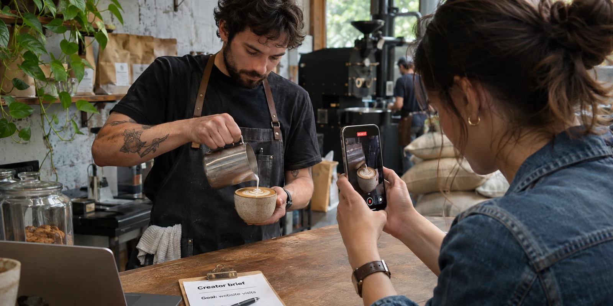

# Tone Stories

[English](README.md)

Tone Stories помогает рекламодателям размещать рекламу в историях Telegram у авторов. Изучите сервис на сайте или откройте бота в Telegram. [Tone Stories](https://tonstories.com/?utm_source=github&utm_medium=referral&utm_campaign=open_source&utm_content=guide) · [Telegram](https://t.me/TON_Storiesbot?start=gh_guide)

## Как подготовить первое размещение

1. **Выберите действие зрителя.** Для интернет-магазина это может быть посещение карточки товара, для Telegram-сервиса — запуск бота. Измеряйте их отдельно.
2. **Заполните [бриф](brief.md).** Укажите аудиторию, даты, бюджет, оффер, ссылку и критерий успеха. Согласуйте с автором формат и способ получения статистики.
3. **Подготовьте креатив.** Покажите предложение на первом экране. Проверьте читаемость на телефоне, звук и адрес назначения. Для публикации через Bot API используйте [Story Preflight](https://github.com/TONstories/telegram-story-preflight).
4. **Разделите источники.** Дайте каждому размещению собственную метку. До публикации проверьте таблицу через [Campaign Link Audit](https://github.com/TONstories/campaign-link-audit).
5. **Сведите результаты.** Запишите время, просмотры, расходы, визиты и подтвержденные целевые действия за согласованный период.

## Пример расчета

Вымышленное размещение стоило 3 000 ₽ и принесло 120 визитов и 12 подтвержденных запусков бота. Визит стоил 25 ₽, запуск — 250 ₽. Такой расчет требует отдельного измерения стартов в самом боте.

## Что согласовать автору

До съемки уточните тезис, длительность, ссылку и срок согласования. После публикации передайте рекламодателю дату и согласованный отчет по размещению.
